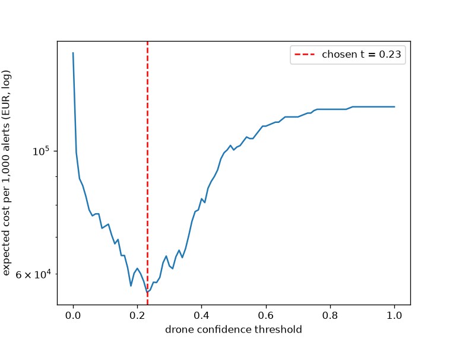

# Assignment 2 Report: drone vs bird alerts at an airport perimeter

- **Name**: Brissa James Ripamonti
- **Student ID**: 19800
- **Email**: bjames.ieu2022@student.ie.edu
- **Group**: BBADBA 5B

## Business problem, and the cost of being wrong

**Decision.** Perimeter cameras at a mid-size airport fire an alert every time
something flies near the runway approach. Today an operator in the operations
room looks at each snapshot and decides: is it a bird (ignore) or a drone
(call the airport security drone-response patrol)? The model supports that
decision. One case = one camera snapshot of a flying object.

Three outcomes: **pass** (bird, no action), **review** (operator checks the
clip), **fail** (drone alert, patrol is sent straight away).

**What each mistake costs.**

| Outcome | Cost | Why |
|---|---|---|
| False negative (drone passed as bird) | **€60,000** | Nobody reacts until a pilot reports it. That forces an unplanned runway closure. Madrid-Barajas closed for about an hour in February 2020 because of drone sightings, with 26 flights diverted. I take €60k as the extra cost of a late, uncontrolled closure (diversions, delays, crew overtime) compared with an early, controlled response. |
| False positive (bird sent as drone) | **€150** | Two security officers and a vehicle go out for about 45 minutes for nothing. |
| True positive (drone alerted) | **€150** | Same patrol call-out. We pay it anyway, but it is the cheapest way to deal with a real drone. |
| True negative | €0 | Bird correctly ignored. |
| Human review | **€0.60** per case | 1 minute of an operator at a loaded cost of €36/hour. |

A missed drone costs **400 times** more than a false alarm. So the model must
be tuned for recall on drones; false alarms are cheap.

**Base rate.** Almost every alert at an airport is a bird. I assume **1 in 500
alerts (0.2%) is a drone**, and **1,500 alerts per day**, i.e. about 3 drones a
day across all cameras. The answer changes if the base rate drops a lot: below
roughly 1 in 5,000, a missed drone becomes so rare that "do nothing" gets close
to the cost of running the model.

## Dataset

- **Roboflow Universe**: workspace `drone-vs-bird-4idpt`, project
  `drone-vs-bird-v3`, **version 4** (public, CC BY 4.0, not forked).
- Link: https://universe.roboflow.com/drone-vs-bird-4idpt/drone-vs-bird-v3/dataset/4
- Object detection, 2 classes: `Bird` (0) and `Drone` (1). **Positive class = Drone.**
- One image = one picture of the sky with one or more birds or one drone,
  which is what a perimeter camera snapshot looks like.
- I picked version 4 because it has no augmentation (versions 2 and 3 triple the
  training set with flips and rotations, which only makes training slower).
- A few label files mix polygons and boxes. YOLO drops those images, so
  `train.py` converts every polygon to its bounding box. No other change.

## What the dataset's composition implies

| Split | Images | Bird boxes | Drone boxes | Images with birds | Images with a drone | Median box size (% of image) Bird / Drone |
|---|---|---|---|---|---|---|
| train | 1,896 | 4,257 | 1,746 | 427 | 1,469 | 0.27% / 0.53% |
| valid | 379 | 1,270 | 351 | 87 | 292 | 0.29% / 0.48% |
| test | 253 | 615 | 237 | 59 | 194 | 0.27% / 0.41% |

88-94% of bird boxes and 71-76% of drone boxes cover less than 1% of the image.
(Computed from the label files by `describe_dataset()` in `train.py`.)

What this implies:

- **Every image contains exactly one class.** There is no empty-sky image and
  no image with a bird and a drone together. So the image-level question
  "is there a drone?" is clean, but the model never learns what an empty sky
  looks like.
- **The test set is 77% drone images, production is 0.2%.** Raw test accuracy
  or precision would be meaningless. All costs are computed with per-class
  rates from the test set re-weighted to the 0.2% base rate.
- **Objects are tiny**: the median box covers well under 1% of the image, and
  most boxes are under 1%. This is the hardest case for a nano model at a small
  image size.
- **Birds have more instances but fewer images** (many birds per flock image).
  Only 59 test images are bird images, so the false-alarm rate on birds is
  measured on 59 images: each image is about 1.7 percentage points. That number
  is the least reliable one in this report.

## Finetuning and baselines

**Model**: `yolo11n` (object detection), finetuned from the COCO checkpoint.
Detection rather than classification because the dataset is labelled with
boxes, and a box tells the operator *where* in the frame the drone is.
Nano because I trained on a laptop CPU.

**Where and how**: MacBook Air M2, CPU only. 3 epochs, image size 416,
batch 16, seed 0, all other settings Ultralytics defaults. About 7 minutes.
I deliberately kept training short (see Limitations).

**Turning detections into a decision.** For each image, the *drone score* is
the highest confidence of any box the model labels `Drone` (0 if none). All
thresholds act on this score. Positive = image contains a drone.

**Detection metrics on test (253 images)**

| Model | mAP50 | mAP50-95 | Drone AP50 |
|---|---|---|---|
| Finetuned yolo11n | **0.587** | **0.233** | **0.790** |
| COCO yolo11n zero-shot | n/a | n/a | 0 (COCO has no drone class) |
| Predict nothing | 0 | 0 | 0 |

**Decision-level comparison on the same test split** (each model at its own
cost-minimising threshold, chosen on the validation split; cost re-weighted to
the 0.2% base rate). For COCO zero-shot I used `airplane` + `kite` as a
stand-in for "drone", since COCO has no drone class.

| Model | Drones caught | Birds flagged as drone | Cost per 1,000 alerts |
|---|---|---|---|
| Predict nothing | 0% | 0% | €120,000 |
| COCO zero-shot (t = 0.38) | 27.8% | 13.6% | €106,980 |
| **Finetuned (t = 0.23)** | **83.5%** | 23.7% | **€55,566** |

The finetuned model beats both baselines: it halves the cost of doing
nothing. The gap to COCO is as large as expected: COCO has never seen a drone,
so it only catches drones that look like a plane or a kite.

## Per-class evaluation and failure modes

**Per class, test split (Ultralytics validation, IoU 0.5)**

| Class | Precision | Recall | AP50 | AP50-95 |
|---|---|---|---|---|
| Bird | 0.422 | 0.486 | 0.383 | 0.114 |
| **Drone (positive)** | 0.781 | 0.753 | **0.790** | 0.351 |

**Drone carries the headline number.** Overall mAP50 (0.587) is the average
of a decent drone AP (0.79) and a poor bird AP (0.38). Birds are worse because
they come in flocks of tiny boxes; the model misses or merges many of them.
For the business decision, bird boxes do not need to be precise: what matters
is that a bird is not called a drone.

**Confusion matrix (instances, test):**

| Predicted \ True | Bird | Drone |
|---|---|---|
| Bird | 426 | **124** |
| Drone | **95** | 107 |
| Background (missed) | 94 | 6 |

**Where it fails.** The main error is **drone ↔ bird confusion**, not missing
objects: 124 of 237 drone boxes are called "bird" at Ultralytics' default
confidence. That is exactly the expensive mistake. At the image level, with
my band, 25 of the 194 drone images (12.9%) still get a drone score under 0.20
and would be passed without anyone looking. Those are small, distant drones
that look like a dark dot, the same as a far-away bird.

## Cost matrix and operating point

Costs are set out in the first section: FN €60,000, FP €150, TP €150,
TN €0, review €0.60, base rate 0.2%.

**Expected cost per alert** = p × (miss rate × 60,000 + catch rate × 150)
+ (1 − p) × (bird false-alarm rate × 150), with p = 0.002. Miss and
false-alarm rates come from the model's scores, so the 77% drone share of the
test set does not leak into the cost.

**Sweep.** I swept the threshold from 0 to 1 in steps of 0.01 on the
**validation** split and took the minimum: **t = 0.23**. I then report it on
test (€55,566 per 1,000 alerts, above). The curve is in
`outputs/cost_curve.png` and in the dashboard.

The curve is very steep on the right: raising the threshold quickly loses
drones, and each lost drone costs 400 false alarms. On the left it climbs
more slowly, because false alarms are cheap individually but there are 499
birds for every drone.

**Assumption that changes the answer most: base rate × cost of a miss**
(0.2% × €60,000 = €120 expected loss per alert). If that fell below about
€43 per alert (for example a miss costing €6,000, or a drone only every
5,000 alerts), the 23.7% bird false-alarm rate at t = 0.23 would make the
model alone *more* expensive than doing nothing.

## What a person still has to check

**Two thresholds** (chosen on validation): **pass below 0.20, review
0.20-0.40, fail (patrol sent) at 0.40 or above.** I searched every pair of
thresholds and kept the cheapest one whose review share fits the people I
have: the operator can spare about **6 hours a day**, i.e. 360 one-minute
checks out of 1,500 alerts, so at most 24% can go to review.

**On test**: 25.5% of alerts go to review → **382 clips a day**, 1 minute
each → **6.4 operator-hours a day**. That is slightly above the 6 hours I
budgeted (the share was 24% on validation, 25.5% on test), so in practice it
needs the existing operator plus some slack, roughly 2 hours per 8-hour shift.
Realistic, but tight.

**Priced against the alternatives (test, per 1,000 alerts, 0.2% base rate):**

| Policy | Drones caught | Review share | Cost per 1,000 |
|---|---|---|---|
| Do nothing | 0% | 0% | €120,000 |
| Model decides alone (t = 0.23) | 83.5% | 0% | €55,566 |
| **Model + review band (0.20-0.40)** | 87.1% | 25.5% | **€23,490** |
| Person checks everything | 100% | 100% | €900 |

The band cuts the model-alone cost by more than half, because uncertain
birds go to a cheap €0.60 check instead of a €150 patrol, and some uncertain
drones get caught by the operator.

**But a person checking everything is far cheaper** (assuming the operator
does not make mistakes). A missed drone is so expensive that the 13% of
drones the model still passes dominate the cost. Checking everything means
1,500 clips = 25 operator-hours a day, about 19 hours more than today (two to
three more people on the rota). At €36/hour that is about €900 a day, which is tiny next to one missed
drone.

**My conclusion: this model is not good enough to decide on its own, and not
good enough to decide what nobody looks at.** With today's staffing the band
is the best option and it is much better than nothing. The right move is to
add review capacity: with the low threshold at 0.03 the model caught 100% of
test drones while sending 52.6% of alerts to review (about 13 operator-hours
a day, €8,227 per 1,000). The model's real value is putting the most
drone-like alerts at the top of the queue and sending the patrol immediately
when the score is very high.

## Limitations & next steps

- **Very short training (3 epochs, 416 px, CPU).** Validation mAP50 went
  0.25 → 0.51 → 0.61 across the three epochs, so it was still improving.
  Next step: train 50+ epochs at 640 px on a GPU (e.g. Colab T4), which should
  mostly help the small drones that are confused with birds.
- **Tiny objects.** Most boxes are under 1% of the image, and 416 px shrinks
  them further. Training at 640 px or more, or using `yolo11s`, would help.
- **No empty-sky images and no mixed images** in the dataset. Real cameras
  also send clouds, planes and insects. I would add such negatives before
  trusting the false-alarm rate.
- **Only 59 bird images in test**, so the bird false-alarm rate moves by
  1.7 points per image. Not a number to make fine decisions on.
- **The review share was chosen on validation (24%) and came out at 25.5%
  on test.** Small split, so the operator load needs a buffer.
- **Operators are assumed to be always right**, and review is assumed to take
  1 minute. If operators miss some drones, the review band and the "check
  everything" option both look better than they really are.
- **Cost figures are estimates**, not airport data. The €60,000 miss cost is
  the number to validate first, with the airport's operations team.
- **The COCO baseline uses airplane + kite as a stand-in** for drone, which is
  a generous but imperfect proxy.

## Generative AI use disclosure

I used Claude (Claude Code) to write the code (dataset download, training call,
evaluation, cost sweep, Gradio dashboard) and to help format this report. The
choice of problem, the cost figures, the base rate and the thresholds were
discussed and checked by me, and I can explain each of them.
